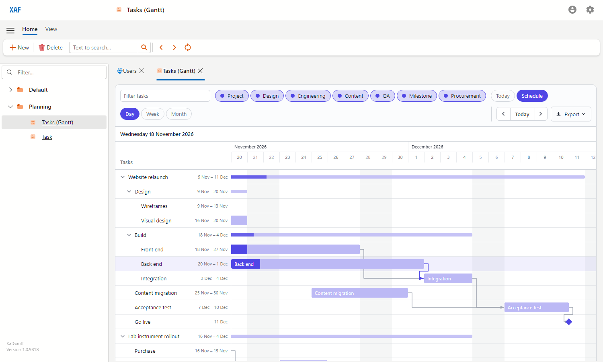
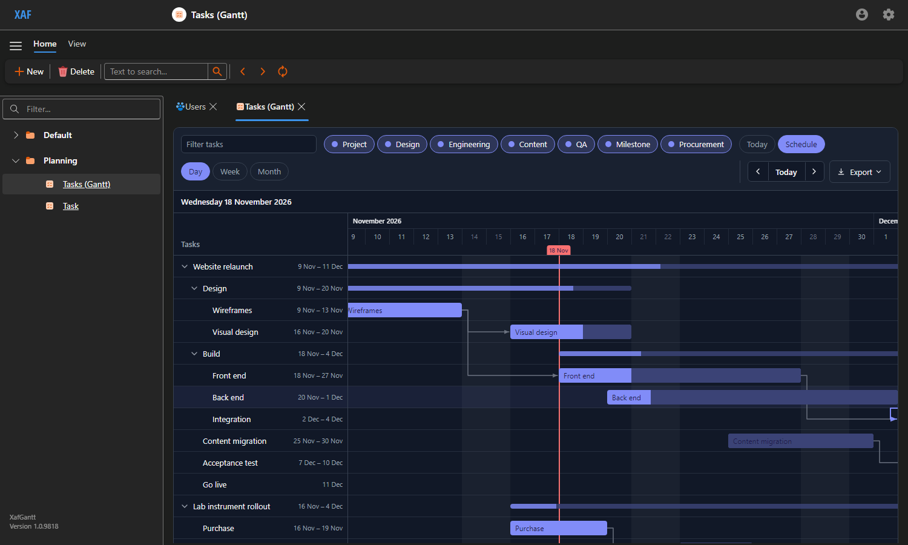

# XafGantt

Proof of concept: the open-source [Veto.Gantt](https://github.com/G-HK/Veto) Blazor component (MIT)
as a list editor in a DevExpress XAF Blazor Server application. XAF Blazor ships no Gantt editor.





What it shows: any business object that implements `IGanttTask` can be displayed as a Gantt chart;
dragging or arrow-keying a bar changes the dates through the ObjectSpace, with XAF validation and
security applied. Results and the list of Veto issues: [docs/veto-findings.md](docs/veto-findings.md).

## Stack

XAF 26.1, .NET 10, EF Core 10, SQL Server LocalDB (catalog `XafGantt`), and `Veto.Gantt`
1.0.8-xafgantt.3: version 1.0.7 plus two fixes (a mouse click selects a draggable bar, and the bar
keeps its width), built from the fork [MBrekhof/Veto](https://github.com/MBrekhof/Veto) and committed
in `local-packages/`. Both fixes are offered upstream in
[G-HK/Veto#28](https://github.com/G-HK/Veto/pull/28).

## Layout

- `XafGantt.Module` - `IGanttTask`, the `ProjectTask` entity, seeding. No Veto reference.
- `XafGantt.Blazor.Server` - `Editors/Gantt`: `GanttListEditor` (the XAF list editor),
  `GanttListView.razor` (wrapper around `VetoGantt`), `GanttItemMapper`. The editor is assigned to
  the view `ProjectTask_ListView_Gantt` in `Model.xafml`.
- `XafGantt.E2ETests` - console app, C# Playwright; the gate.

## Run

An XAF template app only creates its database when started under a debugger. From a terminal, run
the updater once first (PowerShell or cmd, in `C:\Projects\XAFGantt`):

```
dotnet build XafGantt.sln
dotnet run --no-build --project XafGantt.Blazor.Server -- --updateDatabase --silent
dotnet run --no-build --project XafGantt.Blazor.Server
```

Open https://localhost:5001, log in as `Admin` (empty password), choose Planning, Tasks (Gantt).
`Viewer` (empty password) is read-only. The seeded tasks are placed around the current week.

One rule exists to show a rejected drag: a task cannot start in a weekend.

## E2E gate

```
dotnet run --project XafGantt.E2ETests
```

Re-seeds the tasks, starts the app on port 5110, checks rendering, keyboard and pointer drags, the
rejected drag, refresh, context-menu Open, delete, the dark theme and the read-only user, and stops
the app. Exit code 0 means passed. Screenshots land in `XafGantt.E2ETests/bin/Debug/net10.0/screenshots`.

## Using it for another entity

1. Implement `IGanttTask` explicitly on the entity.
2. Add a List View for it in the Model Editor with `EditorType` = `GanttListEditor`,
   `DataAccessMode` = `Client`, `AllowEdit` = `True`, and a navigation item.

## License

[MIT](LICENSE). Veto.Gantt is MIT-licensed by its author (G-HK); its licence text is inside the package in
`local-packages/`. Building and running the app requires a DevExpress licence; no DevExpress code is
in this repository.
